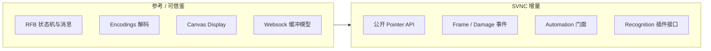
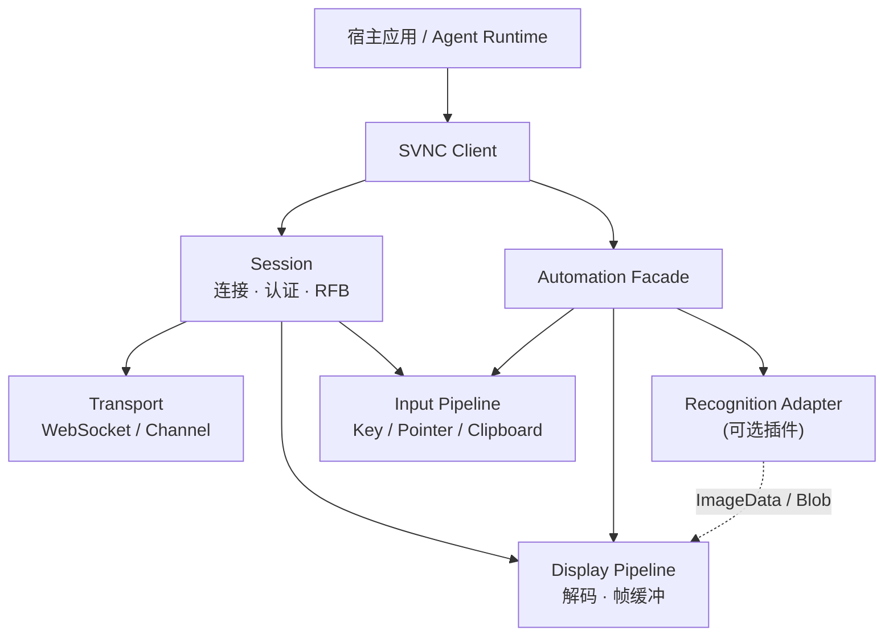
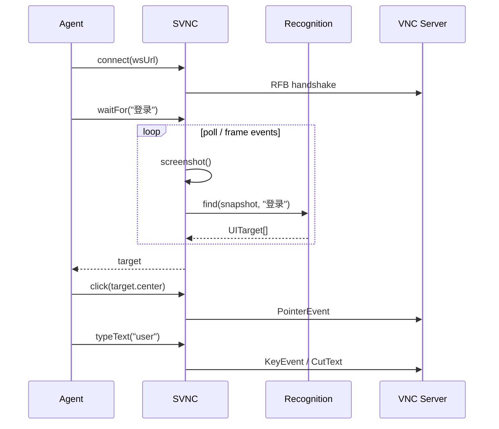

# SVNC 设计提案：可编程远程操控

> 状态：思路与方案整理（无实现代码）  
> 依据：[novnc-analysis.md](./novnc-analysis.md)、[build-vs-wrap-decision.md](./build-vs-wrap-decision.md)、[websockify-decision.md](./websockify-decision.md)；产品目标见 §2.0。**执行顺序与里程碑以 [roadmap.md](./roadmap.md) 为准。**

## 1. 问题陈述

传统 Web VNC（以 noVNC 为代表）优化的是：**人在浏览器里看画面、用鼠标键盘操作远端**。

SVNC 还要服务另一类调用方：**程序 / Agent / 自动化脚本**，它们需要：

1. 稳定拿到远端画面（帧或脏区）
2. 对画面做界面识别（OCR、模板、视觉模型、启发式规则等）
3. 按识别结果注入点击、拖拽、滚轮、按键、输入文本
4. 把「识别 → 决策 → 输入 → 再观察」闭环跑通

noVNC 已提供读屏（`getImageData` / `toDataURL` / `toBlob`）与 `sendKey`，但**缺少稳定的程序化指针 API 与帧更新感知**，也没有 UI 语义层。SVNC 把这些能力提升为一等公民。

## 2. 目标与非目标

### 2.0 产品目标（权威，已锁定）

1. **浏览器网页内**直接使用，满足基础 VNC 功能（连接、显示、人工键鼠）。
2. 提供 **API**：界面识别（可插拔）+ 键盘/鼠标控制，方便未来 **AI Agent** 自动化接入。
3. **暂不考虑**移动端缩放、触摸手势等；后续再另行补充。

### 2.1 工程目标（落实上述产品目标）

| 目标 | 说明 |
|------|------|
| G1 精简可嵌入 | 前端库优先；可选轻量 Demo（对标 `vnc_lite` 级），不强制完整控制条 |
| G2 兼容 RFB 生态 | 经 **WebSocket**（或等价通道）连接现有 VNC Server；经典 TCP VNC 通过 **复用 websockify / 兼容桥或原生 WS Server**（见 [websockify-decision.md](./websockify-decision.md)） |
| G3 程序化输入 | 公开、稳定的桌面坐标指针与键盘/文本 API |
| G4 可观测画面 | 帧快照 +（可选）帧/脏区更新事件，便于识别管线 |
| G5 识别可插拔 | 库提供钩子与数据面；具体 OCR/CV/LLM 作为插件或外部服务 |
| G6 人机双模 | 同一连接既可人工操作，也可脚本驱动（可开关、可仲裁） |

### 2.2 非目标（首期）

- 不重新发明完整 RFB 服务端
- **不自研生产级 websockify 姊妹项目**（桥为可选基建，复用上游；见 websockify-decision）
- 不做移动端缩放 / 手势适配（产品目标 3）
- 不首期做成「远端无障碍树 / UI Automation 控件树」协议（可后续探索旁路通道）
- 不绑定单一视觉模型供应商
- 不要求首期支持无头 Node 全功能（可列为后续；浏览器 Canvas 为默认运行时）

## 3. 与 noVNC 的关系



**策略决策（已收紧，详见 [build-vs-wrap-decision.md](./build-vs-wrap-decision.md)）：**

| 策略 | 优点 | 风险 | 地位 |
|------|------|------|------|
| A. 依赖 `@novnc/novnc`，外包一层 Automation API | 最快验证；复用解码与握手 | 指针可能碰私有 `_sendMouse`；无 frame 事件；升级 fragile | **短期 Spike only** |
| B. 整库 Fork / vendoring 后扩展公开 API | 可正式导出 `sendPointer` 等 | MPL-2.0 与长期 rebase；与上游目标分叉 | **例外**（或仅 decoder 级有限 vendoring） |
| C. 自研精简 RFB 客户端，行为对齐 / 借鉴 noVNC | API 形状完全自主；可现代 TS 工具链；避开历史 UI 债 | 工程量取决于协议裁剪；早期兼容性需自测 | **中长期默认主路径** |

**默认路径：** 短期 **A（可丢弃适配层）** 验证「截图 → 识别 → click/type」→ 中期进入 **C**（Pointer / Frame 为一等契约）。**不以长期 B 为主战略。** API 形态仍按「最终要稳定」设计。

## 4. 逻辑架构



### 4.1 核心概念

- **Session**：一条 RFB 连接的生命周期。
- **Framebuffer**：远端桌面像素；可快照、可订阅更新。
- **InputController**：键盘 / 指针 / 滚轮 / 剪贴板的程序化入口（坐标默认使用**远端桌面坐标**）。
- **Automation**：面向脚本的门面（`click`、`type`、`waitFor`、`screenshot` 等），内部组合 Session + Recognition。
- **Recognition**：可选；输入图像，输出候选目标（框、置信度、文本、标签）。


## 4.2 传输与部署（websockify）

客户端只消费 **WebSocket URL 上的 RFB 字节流**。部署侧：

| 拓扑 | 何时用 |
|------|--------|
| `VNC(TCP) + websockify` | TigerVNC / x11vnc 等经典 Server（**默认 Demo 拓扑**） |
| 原生 WebSocket VNC Server | 环境已提供时优先，省掉桥 |
| 仓库内超薄桥示例 | 可选本地便利；非产品主交付 |

**决策：复用 websockify（或 drop-in），不把「再做一个 websockify」纳入 SVNC 核心。** 细节与证据：[websockify-decision.md](./websockify-decision.md)。

## 5. API 草案（TypeScript 风格，示意）

> 以下为设计草案，非已实现接口。命名可在实现前再评审。

### 5.1 连接

```ts
interface ConnectOptions {
  url: string | WebSocket | RTCDataChannel;
  credentials?: { username?: string; password?: string; target?: string };
  shared?: boolean;
}

class SVNCClient {
  static connect(target: HTMLElement | null, options: ConnectOptions): Promise<SVNCClient>;
  disconnect(): void;
  readonly desktop: { width: number; height: number; name: string };
  on(event: "connect" | "disconnect" | "desktopname" | "clipboard", handler: Function): void;
}
```

`target` 允许 `null` 或离屏 canvas：仅自动化、不展示 UI 时可用（浏览器仍可能需要 canvas 做解码表面——实现阶段验证）。

### 5.2 画面

```ts
interface FrameSnapshot {
  width: number;
  height: number;
  /** RGBA ImageData 或等价视图 */
  imageData: ImageData;
  timestamp: number;
}

interface DamageRect { x: number; y: number; width: number; height: number }

interface SVNCClient {
  screenshot(): FrameSnapshot;
  toDataURL(type?: string, quality?: number): string;
  toBlob(type?: string, quality?: number): Promise<Blob>;

  /** 可选：每次 FramebufferUpdate 刷屏后触发 */
  on(event: "frame", handler: (e: { damage?: DamageRect[] }) => void): void;
}
```

对齐 noVNC 已有能力的部分：`screenshot` ≈ `getImageData()` 封装。增量是 **`frame` 事件**（noVNC 公开 API 缺失）。

### 5.3 输入（关键增量）

```ts
type Button = "left" | "middle" | "right" | "back" | "forward";

interface PointerOptions {
  buttons?: Button[];  // 当前按下的键集合；缺省表示移动
}

interface SVNCClient {
  /** 远端桌面坐标 */
  moveTo(x: number, y: number): void;
  mouseDown(button?: Button): void;
  mouseUp(button?: Button): void;
  click(x: number, y: number, button?: Button): void;
  dblclick(x: number, y: number): void;
  drag(from: { x: number; y: number }, to: { x: number; y: number }): Promise<void>;
  scroll(x: number, y: number, dx: number, dy: number): void;

  keyDown(key: string | number, code?: string): void;
  keyUp(key: string | number, code?: string): void;
  keyPress(key: string | number, code?: string): void;
  typeText(text: string, opts?: { delayMs?: number; viaClipboard?: boolean }): Promise<void>;

  clipboardWrite(text: string): void;
}
```

实现映射：

- 指针 → RFB `PointerEvent`（noVNC 内部为 `RFB.messages.pointerEvent` / `extendedPointerEvent`）
- 键盘 → RFB `KeyEvent` / QEMU Extended Key Event（对齐 `sendKey`）
- `typeText`：短字符串可用系列 `keyPress`；长文本优先 `viaClipboard: true`（对齐 `clipboardPasteFrom` + 远端 Ctrl+V，需考虑远端 OS 差异）

### 5.4 识别与等待（可插拔）

```ts
interface UITarget {
  x: number; y: number; width: number; height: number;
  label?: string;
  text?: string;
  confidence?: number;
}

interface RecognitionProvider {
  find(snapshot: FrameSnapshot, query: string | RegExp | object): Promise<UITarget[]>;
}

interface SVNCClient {
  useRecognition(provider: RecognitionProvider): void;
  find(query: string | RegExp | object): Promise<UITarget[]>;
  waitFor(query: string | RegExp | object, opts?: { timeoutMs?: number; intervalMs?: number }): Promise<UITarget>;
  clickTarget(query: string | RegExp | object): Promise<void>;  // find + click center
}
```

首期可提供：

1. **模板匹配 Provider**（OpenCV.js 或纯 Canvas 相关）
2. **OCR Provider**（Tesseract.js / 远端 OCR 服务）
3. **HTTP Vision Provider**（把截图 POST 到用户自有模型服务）

库本身不内置重模型，避免包体膨胀。

### 5.5 人工与脚本仲裁

```ts
interface SVNCClient {
  /** 'human' | 'script' | 'mixed' */
  inputMode: "human" | "script" | "mixed";
}
```

- `human`：仅 DOM 输入（类 noVNC）
- `script`：忽略或阻断用户输入，只接受 API
- `mixed`：二者都可（默认）；文档中提示竞态风险

## 6. 典型闭环



## 7. 分阶段计划

> 下列为设计阶段草案摘要。**完整工作项、Exit 标准、依赖与风险见 [roadmap.md](./roadmap.md)。**

### Phase 0 — 文档与对齐（本阶段）

- [x] noVNC 架构与功能分析
- [x] SVNC 愿景与 API 草案
- [x] 产品目标锁定：浏览器基础 VNC + Agent API；移动端暂缓
- [x] 实现策略决策：A Spike → C 自研为主（见 [build-vs-wrap-decision.md](./build-vs-wrap-decision.md)）
- [x] 传输决策：复用 websockify / 可选原生 WS；不自研姊妹桥（见 [websockify-decision.md](./websockify-decision.md)）
- [ ] 与仓库所有者确认：许可证、首期识别 Provider 优先级、首期 Server/Encoding 矩阵

### Phase 1 — 最小可操控客户端（MVP）

- 连接 + 显示（可复用/包装 noVNC `RFB`）
- 公开：`screenshot` / `toDataURL`、`click` / `moveTo` / `typeText` / `keyPress`
- Demo 页：按钮触发「截图下载」「按坐标点击」「输入字符串」
- 测试：对着本地 TigerVNC / x11vnc + **上游 websockify**（不自研桥）

### Phase 2 — 可观测性与稳定输入

- `frame` / damage 事件
- 桌面坐标与缩放视口的明确文档与单测
- `drag` / `scroll` / 多键修饰符
- `inputMode` 仲裁
- 错误模型：未连接、viewOnly、越界坐标

### Phase 3 — Recognition 插件

- `RecognitionProvider` 接口与 1～2 个参考实现
- `waitFor` / `clickTarget`
- 示例：自动点开菜单、填表（演示级）

### Phase 4 — 产品化

- 打包（ESM）、TypeScript 类型、CI
- 可选精简 UI 应用（对标 `vnc_lite.html` 而非完整 `ui.js`）
- 性能：截图像素拷贝频率、背压、worker 化识别
- 安全文档：可操控 API 的威胁模型（SSRF 式误用、凭证、审计）

## 8. 风险与开放问题

| # | 问题 | 备注 |
|---|------|------|
| Q1 | 实现策略选 A/B/C？ | **已决策**：A Spike → C 主路径；B 为例外（见 build-vs-wrap-decision） |
| Q2 | 首期是否必须浏览器 DOM？是否要 Node/无头？ | 影响 Display 后端 |
| Q3 | 识别默认做本地插件还是纯远端 API？ | 包体积与隐私 |
| Q4 | `typeText` 在 Windows/Linux/macOS 远端的 IME / 快捷键差异如何处理？ | 可能需要 per-OS profile |
| Q5 | 多客户端共享同一 VNC 会话时的输入冲突 | `shared` 标志与 `inputMode` |
| Q6 | 是否提供「仅数据通道、无像素」的旁路（如 RDP 控件树、辅助功能 API）？ | 超出经典 VNC，可作为实验分支 |
| Q7 | 许可证：自研 MIT/Apache vs 衍生 MPL | 法律评审 |
| Q8 | 与现有项目名 / npm 名 `svnc` 是否冲突 | 发布前检查 |
| Q9 | 是否自研 WebSocket↔TCP 桥？ | **已决策：否**；复用 websockify / 原生 WS / 可选薄 Demo 桥 |

## 9. 建议的仓库布局（实现阶段）

```text
svnc/
  README.md
  docs/
    roadmap.md
    novnc-analysis.md
    design-proposal.md
    build-vs-wrap-decision.md
    websockify-decision.md
  packages/   # 或 src/
    client/   # 连接与 RFB（WebSocket 传输）
    automation/
    recognition-providers/
  examples/
    lite-demo/          # 浏览器基础 VNC + API 按钮
    ws-tcp-bridge/      # 可选超薄桥（非必须）
  tests/
```

当前仅落地 `README.md` 与 `docs/*`。

## 10. 结论

- **产品目标已锁定：** 浏览器基础 VNC；Agent 向识别 + 键鼠 API；移动端暂缓。
- noVNC 提供了坚实的 **RFB-over-WebSocket 显示与人工输入** 基础，并已有 **读屏 + sendKey** 可编程雏形；但上游发布约一年一版、公开 API 不对齐自动化，不宜作为长期唯一实现依赖。
- SVNC 的差异化在于把 **指针注入、帧事件、自动化门面、可插拔界面识别** 做成稳定产品 API，使「直接操作远端被控软件」成为一等场景。
- **客户端策略：** 见 [build-vs-wrap-decision.md](./build-vs-wrap-decision.md)——短期 Wrap Spike，中长期精简自研。
- **传输策略：** 见 [websockify-decision.md](./websockify-decision.md)——**复用 websockify / 原生 WS**；不自研生产级姊妹桥。
- **下一步：** 按 [roadmap.md](./roadmap.md) 做 Phase 0 收尾后进入 Phase 1 Spike（websockify + 本地 VNC → 显示 + `screenshot` / `click` / `typeText`），并冻结 Automation 类型。
