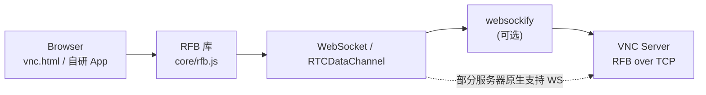
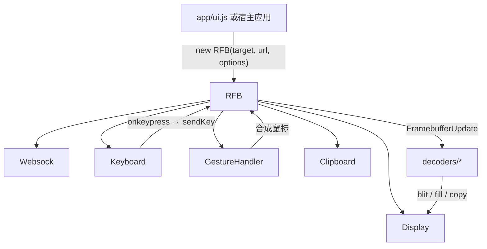

# noVNC 架构与功能分析

> 分析对象： [novnc/noVNC](https://github.com/novnc/noVNC)（本地浅克隆对应 `@novnc/novnc` **1.7.0** 树）。  
> 公开 API 以 `docs/API.md` 为准；内部模块说明参考 `docs/API-internal.md`（官方声明内部 API **不稳定**）。

## 1. 定位与分层

noVNC 同时是：

1. **HTML5 VNC 客户端库**：入口 `core/rfb.js`（`package.json` 的 `exports` 指向该文件），对外暴露单一 `RFB` 类。
2. **完整 Web 应用**：`vnc.html` + `app/ui.js`，带设置面板、控制条、多语言等。
3. **轻量示例**：`vnc_lite.html`，演示如何直接使用库 API。

服务端侧，浏览器不能直连原生 VNC TCP，通常需要 **WebSocket ↔ TCP** 代理；姊妹项目 [websockify](https://github.com/novnc/websockify)，仓库内 `utils/novnc_proxy` 可拉起代理与简易静态服务。

## 2. 目录与模块地图

| 路径 | 职责 |
|------|------|
| `core/rfb.js` | 连接状态机、握手、安全协商、编解码调度、输入汇总、公开 API |
| `core/websock.js` | WebSocket / RTCDataChannel 缓冲封装（收发队列 `rQ*` / `sQ*`） |
| `core/display.js` | 基于 Canvas 的帧缓冲渲染（双缓冲 `_backbuffer` + 可见 canvas） |
| `core/clipboard.js` | 剪贴板事件 |
| `core/input/keyboard.js` | DOM 键盘 → X11 keysym |
| `core/input/gesturehandler.js` | 触摸手势 → 鼠标行为 |
| `core/input/keysym.js` 等 | keysym / scancode 表 |
| `core/decoders/*.js` | 各 RFB encoding 解码器 |
| `core/crypto/*` + `core/ra2.js` | 认证相关密码学（含 RealVNC RSA-AES） |
| `core/encodings.js` | encoding / pseudo-encoding 常量 |
| `core/util/*` | 日志、事件、光标、浏览器探测等 |
| `app/ui.js` | 完整应用 UI 与设置 |
| `app/webutil.js` / `localization.js` | URL/JSON 设置、i18n |
| `utils/novnc_proxy` | 拉起 websockify 的便捷脚本 |
| `docs/API.md` | **稳定**对外 API |
| `docs/LIBRARY.md` / `EMBEDDING.md` | 库嵌入 vs 应用嵌入 |

### 2.1 运行时协作关系

## 3. 协议栈

### 3.1 传输

- 浏览器侧：`WebSocket` 或 `RTCDataChannel`（`RFB` 构造函数 `urlOrChannel`）。
- `Websock` 提供二进制收发队列，不解析 RFB，只做缓冲与 `flush`。
- 多数环境：`Browser ⇄ WS ⇄ websockify ⇄ TCP:5900+ ⇄ VNC Server`。

### 3.2 RFB 握手（摘要）

对应仓库 `docs/rfb_notes` 与官方 RFB 文档：

1. **ProtocolVersion**（如 `RFB 003.008`）
2. **Security / Authentication**（多种 security type）
3. **ClientInitialisation**（shared flag）
4. **ServerInitialisation**（framebuffer 宽高、pixel format、desktop name）
5. 之后进入消息循环：`FramebufferUpdate` / `KeyEvent` / `PointerEvent` / CutText 等

### 3.3 客户端 → 服务端关键消息

| 消息 | RFB type | noVNC 实现要点 |
|------|----------|----------------|
| KeyEvent | 4 | `RFB.messages.keyEvent`；公开方法 `sendKey()`；可选 QEMU Extended Key Event |
| PointerEvent | 5 | `RFB.messages.pointerEvent` / `extendedPointerEvent`；由 `_sendMouse()` 调用 |
| ClientCutText | 6 | 剪贴板；含 Extended Clipboard 伪编码扩展 |
| FramebufferUpdateRequest | 3 | 增量/全量刷新请求 |
| SetEncodings / SetPixelFormat | 2 / 0 | 连接建立后协商 |

### 3.4 服务端 → 客户端

- **FramebufferUpdate**：矩形列表 + encoding，由对应 `core/decoders/*` 解码后写入 `Display`
- **Bell** / **ServerCutText** / 各类 pseudo-encoding（桌面尺寸、光标、连续更新等）

## 4. 功能清单（对照 README + 代码）

### 4.1 认证

README 列出：none、classical VNC、RealVNC RSA-AES、Tight、VeNCrypt Plain、XVP、Apple Diffie-Hellman、UltraVNC MSLogonII。  
代码中 security type 常量见 `core/rfb.js`（如 `securityTypeNone=1`、`VNCAuth=2`、`RA2ne=6`、`Tight=16`、`VeNCrypt=19` 等）。

### 4.2 Encodings

`core/encodings.js` + `core/decoders/`：

| Encoding | 文件 |
|----------|------|
| Raw | `raw.js` |
| CopyRect | `copyrect.js` |
| RRE | `rre.js` |
| Hextile | `hextile.js` |
| Zlib | `zlib.js` |
| Tight | `tight.js` |
| TightPNG | `tightpng.js` |
| ZRLE | `zrle.js` |
| JPEG | `jpeg.js` |
| H.264 | `h264.js`（依赖浏览器 WebCodecs 等能力） |

另有大量 **pseudo-encoding**（质量/压缩等级、DesktopSize、Cursor、ExtendedClipboard、ContinuousUpdates、ExtendedMouseButtons 等）。

### 4.3 显示与视口

- 本地缩放 `scaleViewport`、裁剪 `clipViewport`、拖拽视口 `dragViewport`
- 请求远端改分辨率 `resizeSession`（ExtendedDesktopSize）
- JPEG `qualityLevel`、压缩 `compressionLevel`
- 本地光标渲染（`core/util/cursor.js`）

### 4.4 输入

- 键盘：DOM → keysym；公开 `sendKey(keysym, code, down?)`、`sendCtrlAltDel()`
- 鼠标：canvas 上 `mousedown/mouseup/mousemove/wheel` → `_handleMouse` → `_sendMouse`；**无公开 `sendPointer` / `click` API**
- 触摸：`GestureHandler` 模拟点击、拖拽、滚轮、右键等
- `viewOnly` 时禁止向服务器发送输入

### 4.5 剪贴板与其它

- Unicode 剪贴板（含 Extended Clipboard）
- `bell` 事件；XVP power：`machineShutdown` / `machineReboot` / `machineReset`（需 `capabilities.power`）
- 多语言（`app/locale/`）、移动浏览器适配

### 4.6 已有的“读屏”公开 API（对自动化很关键）

`docs/API.md` 已文档化：

| 方法 | 作用 |
|------|------|
| `getImageData()` | 当前画面 → `ImageData` |
| `toDataURL(type?, encoderOptions?)` | 画面 → data URL |
| `toBlob(callback, type?, quality?)` | 画面 → `Blob` |

实现上委托 `Display` 的 `_backbuffer` canvas（见 `core/display.js`）。

## 5. 公开 API 摘要（稳定面）

构造：`new RFB(target, urlOrChannel, options?)`。

常用属性：`viewOnly`、`scaleViewport`、`clipViewport`、`resizeSession`、`qualityLevel`、`compressionLevel`、`focusOnClick`、`capabilities` 等。

常用方法：`disconnect`、`sendCredentials`、`sendKey`、`sendCtrlAltDel`、`clipboardPasteFrom`、`focus`/`blur`、`getImageData`/`toDataURL`/`toBlob`、电源相关、`approveServer`。

事件：`connect`、`disconnect`、`credentialsrequired`、`securityfailure`、`clipboard`、`bell`、`desktopname`、`capabilities`、`serververification` 等。

完整说明见上游 `docs/API.md`。

## 6. 对「可编程操控 / 自动化」的能力边界

### 6.1 已具备

- **帧导出**：`getImageData` / `toDataURL` / `toBlob`，可直接喂给 OCR、模板匹配、视觉模型。
- **键盘注入**：`sendKey` 为稳定公开 API，可组合出输入字符串、快捷键（需自行处理 keysym/code）。
- **剪贴板注入**：`clipboardPasteFrom`，适合粘贴长文本。
- **库形态清晰**：宿主可只依赖 `RFB`，不必嵌入整套 `app/ui.js`。

### 6.2 缺口与摩擦点（SVNC 重点）

| 缺口 | 说明 |
|------|------|
| **无公开指针 API** | 鼠标仅走 DOM 事件路径（`_handleMouse` → `_sendMouse`）。要程序化点击需：伪造 DOM 事件、调用私有方法，或自行发 `RFB.messages.pointerEvent`（均非稳定契约）。 |
| **无帧更新回调** | 公开事件不包含 “framebuffer updated / dirty rect”。自动化常需轮询 `getImageData`，或深入内部渲染队列。 |
| **无 UI 语义层** | noVNC 只传输像素与输入，不提供控件树、无障碍树、元素定位。界面识别必须完全外挂。 |
| **坐标体系** | 视口缩放/裁剪时，逻辑桌面坐标与 canvas/CSS 坐标需经 `Display.absX/absY` 等转换；公开 API 未封装「按桌面坐标点击」。 |
| **内部 API 不稳定** | `API-internal.md` 明确 Keyboard/Display/Websock 等内部接口不保证稳定。 |
| **人机优先设计** | `focusOnClick`、手势、控制条等面向交互用户；Agent/无头场景需额外适配（含 Node/无 canvas 环境若未来需要）。 |

### 6.3 小结

noVNC 是优秀的 **浏览器内 VNC 显示与人工操控** 实现；对「像操作 SDK 一样驱动远端 GUI」仅覆盖了半边（读屏 + 键盘），**指针注入与感知管线未产品化**。SVNC 应在兼容 RFB/可参考 noVNC 的前提下，把自动化一等公民化。

## 7. 版本与许可备忘

- npm 包名 `@novnc/novnc`，分析时版本树标注 **1.7.0**。
- 主体许可 **MPL-2.0**（`LICENSE.txt` / `docs/LICENSE.MPL-2.0`）；vendor 另有 BSD 等。
- 若 SVNC 衍生或借鉴代码，需单独做许可合规评估（本阶段仅文档分析，未拷贝源码）。
