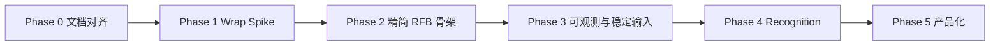

# SVNC 整体路线图

> 状态：规划文档（权威执行顺序）；**Phase 0–5 已落地**；**本地 e2e 拓扑已验证**（见 [e2e-local.md](./e2e-local.md)）  
> 日期：2026-10-12（Asia/Shanghai）  
> 依据：[design-proposal.md](./design-proposal.md)、[build-vs-wrap-decision.md](./build-vs-wrap-decision.md)、[websockify-decision.md](./websockify-decision.md)、[peripheral-security.md](./peripheral-security.md)、[novnc-analysis.md](./novnc-analysis.md)

## 0. 锁定前提（不可随意改范围）

| # | 前提 | 来源 |
|---|------|------|
| P1 | **浏览器**内基础 VNC（连接、显示、人工键鼠） | 产品目标 1 |
| P2 | **API**：界面识别钩子 + 键盘/鼠标/截图，便于 **AI Agent** | 产品目标 2 |
| P3 | **暂不做**移动端缩放 / 触摸手势 | 产品目标 3 |
| P4 | 客户端策略：**短期 Wrap Spike → 中长期精简自研 RFB**；不以整库 Fork 为主 | build-vs-wrap |
| P5 | 传输：**复用 websockify / 原生 WS**；不自研生产级姊妹桥 | websockify-decision |
| P6 | 不首期做完整 noVNC 控制条、H.264、全认证矩阵、远端 UI 控件树 | design-proposal 非目标 |
| P7 | **传输加密放外围**（WSS 反代 / VPN / SSH / 原生 WSS）；**不做** RFB 内 VeNCrypt / RA2 / TLS，除非矩阵强制 | peripheral-security；D7 |



**原则：** 每个 Phase 有明确 **Exit 标准**；Wrap 适配层可丢弃；Automation API 形状尽早冻结，实现可换。

---

## 1. 已完成

| 项 | 文档 / 产出 |
|----|-------------|
| noVNC 架构与自动化缺口分析 | [novnc-analysis.md](./novnc-analysis.md) |
| 愿景、逻辑架构、API 草案、早期分阶段设想 | [design-proposal.md](./design-proposal.md) |
| Wrap / Fork / 自研决策 | [build-vs-wrap-decision.md](./build-vs-wrap-decision.md) |
| websockify 复用决策 | [websockify-decision.md](./websockify-decision.md) |
| 产品目标 1–3 写入 README | [README.md](../README.md) |
| P0 开放决策 D1–D6 关闭 | 本文件 §11；[compat-matrix.md](./compat-matrix.md) |
| 仓库骨架（`src/` / `examples/` / MIT） | `package.json`、`LICENSE`、`.gitignore` |
| 外围 TLS 策略（D7） | [peripheral-security.md](./peripheral-security.md)；本文件 §11 |

---

## 2. Phase 0 — 开工对齐（**已完成**）

**目标：** 把「还差一纸确认」的事项定下来，避免 Spike 中途改许可证或 Server 矩阵。

| 工作项 | 交付物 | 状态 |
|--------|--------|------|
| 0.1 许可证 | README + `LICENSE`：**MIT**（D1） | ✅ |
| 0.2 Server × Auth × Encoding | [compat-matrix.md](./compat-matrix.md)：TigerVNC + none/VNC Auth + **Raw**，下一步 **Tight** | ✅ |
| 0.3 Recognition 首期范围 | **不做内置识别**；仅 **截图 API** 交给外部 AI Agent（D3） | ✅ |
| 0.4 仓库骨架 | 单包 `src/` + `examples/` + `.gitignore` + `package.json`（D5） | ✅ |
| 0.5 npm 名 | **`svnc`**（查询时未被占用）（D4） | ✅ |
| 0.6 自动化会话 | 非 **viewOnly**（D6） | ✅ |

**Exit：** 已满足——矩阵有必过拓扑；许可证已定；可开始 Phase 1 编码。

---

## 3. Phase 1 — Wrap Spike（可丢弃）

**状态：实现已合并；本地 e2e 已跑通（2026-10-12，x11vnc+websockify）**

**目标：** 用 `@novnc/novnc` 薄适配，在真实拓扑上跑通 **看屏 + screenshot + 桌面坐标 click + typeText**，并 **冻结 Automation TypeScript 接口**（实现可换）。

| 工作项 | 交付物 | 依赖 |
|--------|--------|------|
| 1.1 本地拓扑脚本/文档 | `examples/spike/` 或 docs：`TigerVNC/x11vnc + websockify + 静态页` | P5 |
| 1.2 适配层隔离 | `adapters/novnc-legacy.ts`（或等价）：私有 `_sendMouse` / `RFB.messages` 仅出现于此 | `@novnc/novnc` |
| 1.3 基础显示 | 浏览器页可连接、渲染桌面 | 1.1 |
| 1.4 Automation MVP | `screenshot` / `toDataURL`、`moveTo`、`click`、`keyPress`、`typeText` | 1.2–1.3 |
| 1.5 Demo 控件 | 按钮：截图下载、按坐标点击、输入字符串 | 1.4 |
| 1.6 冻结契约 | `src/automation/types.ts`（或 `docs/api-draft.d.ts`）：坐标空间=远端桌面像素；错误：未连接 / viewOnly / 越界；会话非 viewOnly（D6） | design-proposal §5 |
| 1.7 Spike 验收笔记 | 简短 `docs/spike-notes.md`：踩坑、是否触发晋级自研 | 1.4–1.6 |

**Exit（晋级 Phase 2）：**

1. 人工可完成基础 VNC 会话；且  
2. 脚本/按钮可完成「截图 → click → typeText → 再截图」；且  
3. Automation 类型已提交；适配层边界清晰。

**不做：** frame/damage 事件强依赖、Recognition 真实现、移动适配、自研桥、完整 UI 壳。

**预估：** 约 1–2 周（单人兼职按熟悉度浮动）。

**风险：** 挂私有 API → 升级 fragile（可接受，因 Spike 可丢）；坐标与 CSS 缩放不一致 → Demo **禁止 scaleViewport** 或文档强制「逻辑桌面坐标」。

---

## 4. Phase 2 — 精简自研 RFB 骨架

**状态：实现已合并（2026-10-12）；默认 `SVNCClient`；Wrap **已退役**（无 `@novnc` 依赖）**

**目标：** 替换 Wrap 成为主实现路径；公开 API 形状与 Phase 1 契约对齐；协议面 **裁剪**。

| 工作项 | 交付物 | 依赖 |
|--------|--------|------|
| 2.1 工程脚手架 | TypeScript + ESM 打包（Vite/tsup 等）、基础 lint/test | Phase 0 骨架 |
| 2.2 Transport | WebSocket 二进制收发缓冲（可借鉴 websock 模型，**不**复制 MPL 大段源） | — |
| 2.3 握手最小集 | ProtocolVersion → Security **none + VNC Auth** → Client/ServerInit | compat-matrix |
| 2.4 显示最小集 | FramebufferUpdate **Raw**（优先）；Canvas Display | 2.2–2.3 |
| 2.5 输入一等公民 | PointerEvent + KeyEvent；映射到已冻结的 `click` / `typeText` 等 | Phase 1 契约 |
| 2.6 编码扩展 1 | **Tight**（D2；按 [compat-matrix.md](./compat-matrix.md)） | 2.4 稳定后 |
| 2.7 对照测试 | 同场景对照 noVNC 像素/输入（手工或半自动）；CI 能起 websockify+VNC 更佳 | 1.1 拓扑 |
| 2.8 退役 Wrap | ✅ Demo/默认仅 lean RFB；`@novnc/novnc` 已从 package 移除；适配层 → `examples/archive` | 完成 |

**Exit：** 在矩阵「必过」拓扑上，自研客户端独立完成 Phase 1 同级 Demo；不再依赖 `@novnc/novnc` 运行时（可选留作对照）。

**不做：** H.264、RA2/VeNCrypt 等冷门认证、完整伪编码、手势、控制条。

**预估：** 约 3–6 周（视编码/认证坑深度）。

**风险：** 兼容性不足 → 严格按矩阵扩，拒绝「支持一切 VNC」；误拷 noVNC 源 → SPDX 审查 + 禁止无记录粘贴。

**触发提前开干（相对 Spike）：** 需要稳定 `frame`/`damage`，或 Wrap 私有 API 已两次被升级打断（见 build-vs-wrap §5.3）。

---

## 5. Phase 3 — 可观测性与稳定输入

**状态：实现已合并（2026-10-12）**

**目标：** Agent 闭环所需的「何时再看屏」与完整指针语义；人机双模。

| 工作项 | 交付物 |
|--------|--------|
| 3.1 `frame` / damage 事件 | 每次 FramebufferUpdate 刷屏后可订阅；含可选脏区列表 |
| 3.2 坐标与视口文档 + 单测 | 仅桌面坐标；若日后有缩放，转换集中在一处（移动端仍非目标） |
| 3.3 丰富输入 | `drag`、`scroll`、修饰键组合、`dblclick` |
| 3.4 `inputMode` | `human` / `script` / `mixed` 仲裁 |
| 3.5 错误模型 | 统一错误类型与文档 |
| 3.6 剪贴板通路 | `clipboardWrite` + `typeText({ viaClipboard: true })` 路径说明（OS 差异写入已知问题） |

**Exit：** Agent 可用事件驱动轮询替代纯 sleep；拖拽/滚轮有 Demo 或测试。

**预估：** 约 1–2 周。

---

## 6. Phase 4 — Recognition 插件（可选；首期不做）

**状态：接口/stubs/Agent 示例已合并；无内置视觉（D3）**

**目标：** 可插拔界面识别，打通 `waitFor` / `clickTarget`。

**Phase 0 已定（D3）：** 首期 **不做内置识别**。Agent 通过 **`screenshot` / `toDataURL`** 自行分析与决策；本 Phase 延后到确有内置 Provider 需求时再开。

| 工作项 | 交付物 |
|--------|--------|
| 4.1 `RecognitionProvider` 接口 | 与 design-proposal §5.4 对齐并定稿（可选） |
| 4.2 参考实现（可选） | 模板 / OCR / HTTP Vision 择一，证明可插拔 |
| 4.3 门面 API | `find` / `waitFor` / `clickTarget` |
| 4.4 Agent 示例 | 「截图 →（外部 Agent）→ 点击 / 输入」端到端示例 |

**Exit：** 外部 Agent 仅用公开截图 + 输入 API 即可闭环；内置 Provider 非门禁。

**原则：** 库不内置重模型；识别逻辑默认在 Agent 侧。

**预估：** 约 2–3 周（有需求时）。

---

## 7. Phase 5 — 产品化

**状态：已完成（2026-10-12）；首个公开 tag `0.1.0`**

**目标：** 可发布、可嵌入、可说明威胁模型。

| 工作项 | 交付物 | 状态 |
|--------|--------|------|
| 5.1 打包与类型 | ESM + `.d.ts`（`tsc`）、[CHANGELOG.md](../CHANGELOG.md)、`package.json` exports | ✅ |
| 5.2 CI | 工作流定义见 [ci.md](./ci.md)（typecheck / test / build）；若推送账号无 `workflow` scope，由维护者粘贴到 `.github/workflows/ci.yml` | ✅ |
| 5.3 Lite 应用 | [examples/lite/](../examples/lite/)（对标 vnc_lite；完整控件见 [examples/demo/](../examples/demo/)） | ✅ |
| 5.4 性能 | 按需：首期不强制 worker；截图像素拷贝语义见 Automation 契约 | ✅（文档约定） |
| 5.5 安全文档 | [security.md](./security.md) + [peripheral-security.md](./peripheral-security.md) | ✅ |
| 5.6 可选薄桥示例 | [examples/ws-tcp-bridge/](../examples/ws-tcp-bridge/)（**非生产**；默认仍推 websockify） | ✅ |
| 5.7 许可落地 | MIT `LICENSE`；[NOTICE](../NOTICE)（运行时依赖许可证摘要） | ✅ |

**Exit：** 已满足——semver `0.1.0`；README 快速开始可用。

---

## 8. 明确延后（Backlog，非本路线图主路径）

| 项 | 说明 |
|----|------|
| 移动端缩放 / 手势 | 产品目标 3 |
| 完整控制条 / i18n 设置中心 | 非差异化 |
| 自研生产级 websockify | 已否决 |
| H.264 / 冷门 encoding | 无用户故事不加 |
| VeNCrypt / RA2 / RFB-TLS（客户端） | **D7 正式否决默认实现**；仅矩阵强制时重开；见 [peripheral-security.md](./peripheral-security.md) |
| Node 无头一等运行时 | 浏览器 Canvas 为默认 |
| 远端无障碍树 / 非 RFB 旁路 | 实验分支另议 |
| 整库 Fork noVNC | 仅例外（解码器级有限 vendoring） |

---

## 9. 依赖关系（跨 Phase）

```text
websockify（外部进程） ──► 所有浏览器↔经典 TCP VNC 的 Demo/CI
        │
compat-matrix ──► Phase 1 验收 & Phase 2 协议裁剪
        │
Automation types（Phase 1 冻结） ──► Phase 2/3/4 实现不得无故改契约
        │
自研 Display + frame 事件（Phase 2–3） ──► 高效 Recognition（Phase 4）
```

| 外部依赖 | 用途 | 备注 |
|----------|------|------|
| TigerVNC 或 x11vnc | 参考 Server | 矩阵必过项 |
| websockify | WS↔TCP | 独立进程；LGPL |
| `@novnc/novnc` | Phase 1 Spike only | **已移除运行时依赖**；对照见 `examples/archive` |
| 浏览器 Canvas / WebSocket | 运行时 | 无 Raw TCP |

---

## 10. 风险登记

| ID | 风险 | 阶段 | 缓解 |
|----|------|------|------|
| R1 | Wrap 私有 API 升级断裂 | P1 | 隔离适配层；设删除日期；尽快进 P2 |
| R2 | 自研编码/认证坑深 | P2 | 矩阵裁剪；先 Raw；对照 noVNC |
| R3 | 桌面坐标 vs 缩放视口混乱 | P1–P3 | Demo 禁用缩放；单测锁契约 |
| R4 | `typeText` 跨 OS/IME 差异 | P3–P4 | 剪贴板路径；per-OS 已知问题表 |
| R5 | 误分发开放 TCP 中继 | 全程 | 文档强调目标白名单；示例固定 backend |
| R6 | MPL/LGPL 合规疏忽 | P2 / P5 | 禁止无记录复制；桥不链进库 |
| R7 | 范围膨胀（移动/全协议/自研桥） | 全程 | 本文件 P1–P6；变更需改路线图并评审 |
| R8 | 多人 shared 会话输入冲突 | P3 | `inputMode` + 文档 |
| R9 | 把「要加密」误解成必须实现 VeNCrypt | 全程 | D7 + peripheral-security：默认 WSS/VPN |

---

## 11. 开放决策（**已关闭**）

| ID | 问题 | 决定 | 状态 |
|----|------|------|------|
| D1 | 自研代码许可证 | **MIT**（`LICENSE` + `package.json`） | ✅ 已关闭 |
| D2 | Raw 之后 Encoding 第二优先 | **Tight**（ZRLE 不进首期第二优先） | ✅ 已关闭 |
| D3 | 首期 Recognition | **不做内置识别**；仅提供 **截图 API**，由外部 AI Agent 分析决策 | ✅ 已关闭 |
| D4 | npm 包名 | **`svnc`**（查询时未被占用） | ✅ 已关闭 |
| D5 | 仓库布局 | **单包 `src/`**（必要时再拆） | ✅ 已关闭 |
| D6 | 自动化测试会话 | **非 viewOnly**（`click` / `typeText` 必可注入） | ✅ 已关闭 |
| D7 | 传输加密 vs RFB 内 TLS/VeNCrypt/RA2 | **外围优先**（WSS 反代 / VPN / SSH / 原生 WSS）；SVNC 只做 **None + VNC Auth**；**不在 RFB 客户端实现 VeNCrypt / RA2 / RFB-TLS**，除非 [compat-matrix](./compat-matrix.md) 新增不可替代的强制拓扑 | ✅ 已关闭 |

此前已关闭：实现策略 A→C、不自研桥、移动端暂缓、产品目标 1–3。

兼容矩阵 stub：[compat-matrix.md](./compat-matrix.md)（TigerVNC + none/VNC Auth + Raw，下一步 Tight）。

---

## 12. 建议执行顺序（清单）

可直接当看板：

1. **[P0]** ~~拍板 D1–D6；compat-matrix；骨架~~ **已完成**  
2. **[P1]** 拉起 `TigerVNC + websockify`；Wrap Demo：显示 + screenshot/click/typeText（非 viewOnly）  
3. **[P1]** 提交并冻结 Automation `.ts` 类型于 `src/`；写 spike-notes  
4. **[P2]** TS 脚手架 + Transport + none/VNCAuth + Raw + Canvas  
5. **[P2]** 指针/键盘接到同一 Automation API；加 **Tight**；切默认实现  
6. **[P3]** `frame`/damage、`drag`/`scroll`、`inputMode`、错误模型  
7. **[P4]** （可选）RecognitionProvider；默认路径仍是 Agent 侧消费截图  
8. **[P5]** ~~打包、CI、安全文档、首个 tag~~ **已完成（`0.1.0`）**  

---

## 13. 相关文档

| 文档 | 角色 |
|------|------|
| [design-proposal.md](./design-proposal.md) | 架构与 API 草案（细节以本路线图顺序为准） |
| [build-vs-wrap-decision.md](./build-vs-wrap-decision.md) | 为何 Spike 后自研 |
| [websockify-decision.md](./websockify-decision.md) | 为何不自研桥 |
| [novnc-analysis.md](./novnc-analysis.md) | 上游能力边界 |
| [lean-rfb-gaps.md](./lean-rfb-gaps.md) | 自研 RFB 缺口与缓解 |
| [compat-matrix.md](./compat-matrix.md) | 首期 Server × Auth × Encoding |
| [peripheral-security.md](./peripheral-security.md) | 外围加密 vs RFB VeNCrypt（D7） |
| [security.md](./security.md) | Automation API 威胁模型 |
| [lean-rfb-gaps.md](./lean-rfb-gaps.md) | 自研 RFB 缺口与延后项 |

**下一步：** 按需 npm 发布、或扩展矩阵 Server；VeNCrypt 不进主路径（D7）。
