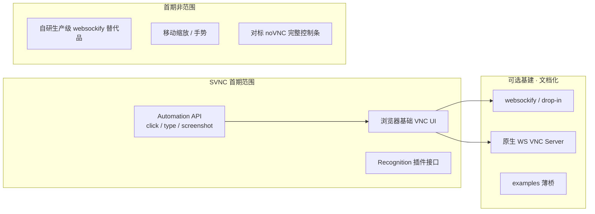

# Websockify：复用 vs 自研 WebSocket↔TCP 桥

> 调研日期：2026-10-12（Asia/Shanghai）  
> 数据来源：[novnc/websockify](https://github.com/novnc/websockify) GitHub Releases / commits / issues、[websockify-js](https://github.com/novnc/websockify-js)、[TigerVNC#1768](https://github.com/TigerVNC/tigervnc/issues/1768)、既有 SVNC 设计文档。  
> **统计均为当时快照。**

## 1. 结论（先看）

**推荐：把 WebSocket↔TCP 桥当作可选基础设施复用，不把「再做一个 websockify」做成 SVNC 产品目标。**

| 选择 | 地位 |
|------|------|
| 上游 Python [websockify](https://github.com/novnc/websockify)（或兼容 drop-in） | **默认复用**，文档与 Demo 里写清如何启动 |
| 原生 WebSocket 的 VNC Server（若目标环境有） | **优先**：可完全省掉桥 |
| 仓库内超薄 Node/Go 转发 Demo（~百行级） | **可选**，仅本地/CI 便利，不复制 token/auth/LD_PRELOAD 等全家桶 |
| 自研并长期维护姊妹「svnc-websockify」产品 | **不做**（除非未来有明确生产运维缺口且上游不可用） |

SVNC **客户端**只依赖标准浏览器 WebSocket（二进制帧里跑 RFB 字节流）。桥在服务端侧；与 noVNC 历史姊妹关系 **不等于** 库代码耦合。

---

## 2. 为什么浏览器场景几乎总要「桥或原生 WS」

```text
浏览器 ──WebSocket──► [可选: WSS 终止 / 反代]
                         │
                         ▼
              ┌─ A. 原生 WebSocket 的 VNC Server ──► 直接 RFB
              └─ B. WebSocket↔TCP 桥 ──TCP──► 经典 VNC :5900
```

- 浏览器 **不能** 打开任意原始 TCP socket（无通用 Raw TCP API）。
- 经典 VNC（TigerVNC、x11vnc、多数 `:5900`）讲的是 **裸 TCP 上的 RFB**，不是 WebSocket。
- 因此二选一：**(A) Server 自己提供 WebSocket**，或 **(B) 中间件把 WS 帧与 TCP 字节互转**。

**nginx 说明：** `http` 的 `proxy_pass` + Upgrade 只能把 WebSocket **原样转到已会 WebSocket 的后端**；`stream` 是 TCP↔TCP。它们 **都不能** 单独完成「浏览器 WS ↔ 裸 RFB TCP」转换。Cloudflare 等边缘产品同理：除非后端已是 WS，否则仍要桥或原生 WS Server。

---

## 3. websockify 是什么、和 noVNC 怎么绑

- 原名 wsproxy，曾属 noVNC 项目；现独立仓库，定位：**通用 WebSocket → TCP 代理**（不限 VNC）。
- 握手后双向转发；自 0.5.0 起仅支持 IETF 6455，**二进制**载荷（不再要旧 Base64 模式）。
- 附加能力（对 SVNC 非刚需）：`--web` 迷你静态站、`--cert` WSS、token 插件、auth 插件、`LD_PRELOAD` wrap 程序、录像等。
- 姊妹实现：[websockify-js](https://github.com/novnc/websockify-js)（Node）、[websockify-other](https://github.com/novnc/websockify-other)（C 等）；另有社区 Go/Rust 实现（如 go-websockify、rs-wsProxy）。

**与客户端耦合：** noVNC / 未来的 SVNC 客户端把 RFB 放进 **标准 WebSocket 二进制帧**。只要桥做透明字节转发，**无需** 绑定 websockify 私有协议。可选的 `Sec-WebSocket-Protocol` / token 查询参数是部署约定，不是 RFB 本身。

---

## 4. 维护与许可（证据）

### 4.1 上游 Python websockify（2026-10-12）

| 指标 | 值 |
|------|-----|
| Stars | ~4 473 |
| License | **LGPL-3.0** |
| 最近 push | 2026-05-24 |
| 最新稳定 Release | **v0.13.0**（2025-02-12） |
| 距调研日 | 约 **607 天**无新稳定版 |
| 开放 issues（Search） | ~35；其中标 bug 约 11 |
| 提交量（约） | 2022: 31；2023: 9；2024: 15；**2025: 45**；**2026 YTD: 9** |

近期合并多为 Python 3.13、CI、TLS/测试修复——**仍有维护，但发布偏慢**。开放 issue 含 Py3.14 pickle、插件初始化、缓存头等，说明生产硬化仍有社区摩擦。

### 4.2 websockify-js

- 最近有意义提交停在约 **2019–2020**；`pushed_at` 约 2023-07，**不宜当作 SVNC 默认依赖**。

### 4.3 上游对「生产就绪」的态度

[TigerVNC#1768](https://github.com/TigerVNC/tigervnc/issues/1768)（2024-06 开，至 2026-05 仍有 +1）由 Cendio 维护者提出：希望 TigerVNC **原生 WebSocket**，替代方案写明：

> Running a WebSocket proxy. Unfortunately, the only easily available one is websockify, which is **not really a production-ready thing**.

解读：生态默认仍推 websockify，但 **连 noVNC/TigerVNC 相关维护者也承认它偏「够用工具」而非强生产套件**。这支持「复用 + 文档化局限」，**不支持**「SVNC 再造一个功能对等的姊妹项目当核心交付」。

### 4.4 许可对 SVNC 的含义

- **独立进程**跑 LGPL 的 websockify：客户端/自研桥若为分离程序，通常不强制主项目整库变 LGPL（具体以法务为准）。
- **链进同一二进制/改库分发**：LGPL 义务更重。
- 因此默认姿态：**外部依赖 / 容器旁路**，不把 websockify 源码 vendoring 进 SVNC 核心包。

---

## 5. 替代路径对比

| 路径 | 适用 | 优点 | 缺点 |
|------|------|------|------|
| **复用 websockify** | 连 TigerVNC / x11vnc 等经典 TCP VNC | 生态默认；Docker 镜像现成；token 等可选 | 发布慢；生产硬化需自运维；LGPL 进程 |
| **原生 WS 的 VNC Server** | TurboVNC 等已提供 WS 的环境；部分商业方案 | **零桥**；少一跳延迟与故障面 | 不能覆盖所有目标机；TigerVNC 原生 WS 仍为开放需求 |
| **自研薄桥（Node/Go）** | 本地 Demo、单二进制分发、固定 `host:port` | 依赖面小；许可自控；易嵌 examples | 要自己处理背压、TLS、目标校验（防开放代理） |
| **自研「全家桶 websockify」** | 几乎无 | 可控 | 与 SVNC 产品目标（浏览器库 + Agent API）正交；重复造轮子 |
| **仅 nginx/Caddy/CF** | 后端已是 WS | 标准边缘终结 WSS | **不能**单独替代 WS↔TCP |

---

## 6. 对 SVNC 产品边界的含义（对齐锁定目标）

权威产品目标（见 README / design-proposal）：

1. **浏览器页内**可用的基础 VNC（看屏 + 键鼠）。
2. **API**：界面识别钩子 + 键盘/鼠标控制，便于未来 AI Agent。
3. **暂不考虑**移动端缩放/手势等；以后再补。

推导：

- 目标 1–2 都是 **客户端 / 库** 能力；传输只需「连上一个提供 RFB 字节流的 WebSocket URL」。
- 桥属于 **部署拓扑**，不是 Automation API 的一部分。
- **不**把移动适配、完整控制条、websockify 功能对等实现塞进首期。



---

## 7. 推荐落地做法

1. **文档与 Demo**：默认示例使用 `websockify <listen> <vnc-host:5900>`（或官方 Docker）；注明 WSS、勿做成开放 TCP 中继（必须固定或白名单目标）。
2. **客户端契约**：`ConnectOptions.url` = WebSocket URL（或已有 `WebSocket`）；**不**在库内启动桥。
3. **兼容矩阵**（实现阶段）：`Server × 是否需桥 × Auth × Encoding`；TigerVNC/x11vnc → 需桥；已知原生 WS 的 Server → 直连。
4. **可选**：`examples/ws-tcp-bridge/` 超薄实现（固定后端、二进制帧、可选 TLS 终止交给前置反代）——**明确标注非生产替代品**。
5. **仅当**出现下列情况再评估「自研桥产品化」：目标部署禁止 Python/LGPL、websockify 连续无法满足安全基线、且无可用原生 WS Server——仍应先评估 Go drop-in 而非扩 scope。

---

## 8. 与既有决策的关系

- [build-vs-wrap-decision.md](./build-vs-wrap-decision.md)：客户端 **精简自研 RFB**；传输缓冲可借鉴 noVNC websock 模型。  
- **桥的决策独立且更简单：复用，不自研姊妹项目。**  
- Phase 1 MVP 测试拓扑保持：`TigerVNC/x11vnc + websockify + SVNC 页`。

---

## 9. 参考链接

- websockify：https://github.com/novnc/websockify  
- Release v0.13.0：https://github.com/novnc/websockify/releases/tag/v0.13.0  
- websockify-js：https://github.com/novnc/websockify-js  
- TigerVNC WebSocket 需求：https://github.com/TigerVNC/tigervnc/issues/1768  
- noVNC：https://github.com/novnc/noVNC  
- 本仓库：[design-proposal.md](./design-proposal.md)、[build-vs-wrap-decision.md](./build-vs-wrap-decision.md)
